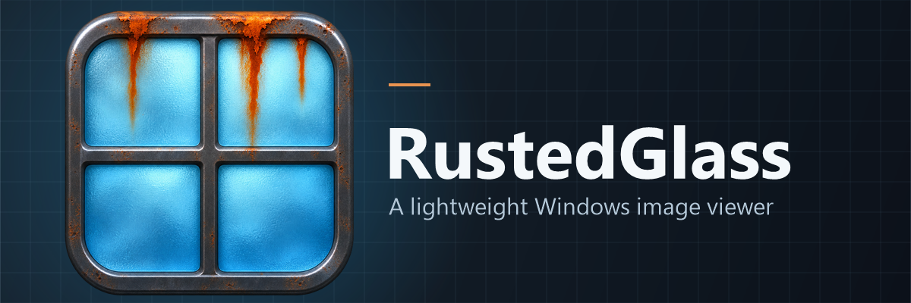
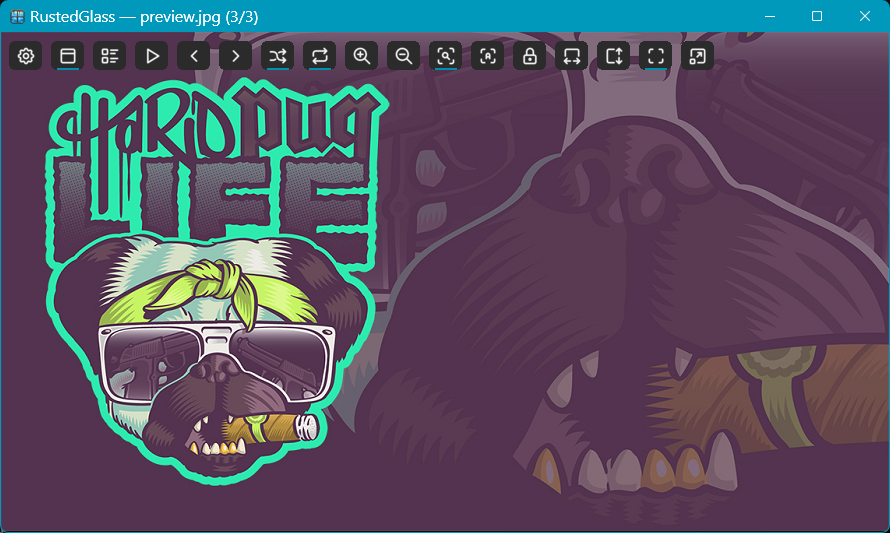

# RustedGlass



RustedGlass is a fast, portable, Rust-based Windows image viewer with a minimal interface that combines lightning-fast browsing with a lean memory footprint.

---

### 1.1.0 - Major update! Huge speed boost in handling large image collections. Playlist redesign allows you to see the images you're browsing. Triggerable auto-updates from the About dialog. Dozens of bugs and edge-cases squashed. Enjoy!

---

## Getting started

1. Download the Windows ZIP, extract it to a folder you can write to, and run `RustedGlass.exe`. [GitHub Releases](https://github.com/iamarxs/RustedGlass/releases/latest)
2. Press **O** to open images or **F** to open a folder. You can also drag an image, folder, or playlist onto the viewer.
3. Use the **arrow keys** or **mouse wheel** to browse. **Home** and **End** jump to the first and last images. When you open a large folder, images appear as they’re found, the title bar shows the growing count, and the UI remains reactive.

Press **F1** for the full shortcut list. Right-click the image or playlist for its menu, or press **S** to open Settings.

## Features

- Plain simple. Browse with the keyboard, mouse wheel, or toolbar.
- Minimal interface. Optionally hidable toolbar and a borderless mode, a simple settings menu and all functionality available through keyboard shortcuts and the right-click menu.
- Switch between framed, borderless, and fullscreen views, or keep the viewer on top. Window position and size are restored on restart.
- Inspect an image's full path, file size, dimensions, detected format, and available EXIF details. Copy the displayed image to the clipboard at its native resolution.
- Rename, copy, move, and recycle files or reveal them in Explorer. Copy and move use numbered filenames when the destination already contains a file with the same name.
- Browse rapidly with a cache for recently decoded still images.
- All operations that could cause the app to hang or slow down are handled by background workers, keeping the UI snappy and responsive. Images and their metadata are fetched in the background.
- Zoom in place. Use **Ctrl + Wheel** to zoom toward the pointer or **Z** to enter an exact percentage.

You can check for and automatically update signed releases from **About RustedGlass → Check for updates**.

## Viewing images

| Shortcut            | Action                                         |
| ------------------- | ---------------------------------------------- |
| **Ctrl + wheel**    | Zoom around the pointer                        |
| **Z**               | Enter an exact zoom percentage                 |
| **0**               | Fit the image to the window                    |
| **R** / **I**       | Rotate the view / show image information       |
| **F10** / **F12**   | Toggle the window frame / toggle full screen   |
| **T**               | Show or hide the toolbar                       |
| **F11** / **Space** | Start or stop a slideshow / pause or resume it |

Settings lets you enable drag-to-pan and set a fixed or random slideshow interval. You can loop the slideshow and let animated GIF, APNG, and WebP images finish a cycle before advancing. **Ctrl + A** toggles random browsing and slideshow order while keeping playlist rows in place.

**Supported formats** include JPEG, PNG, WebP, TIFF, BMP, GIF, ICO, QOI, TGA, DDS, Radiance HDR, OpenEXR, Farbfeld, and Netpbm, including APNG and animated WebP.

## Working with playlists

- Press **L** to show the playlist beside the image. Click a row to view it or drag rows to rearrange them. Click a header to sort by name, full path, width, height, type, size or modification date. Use the **Columns** menu to choose which details to show.
- Press **A** to add images or **Shift + A** to add a folder. Drops onto the playlist pane append rows. Dropping a single playlist onto the image opens it.
- Right-click the playlist to **Remove duplicates** or **Shuffle rows**. **Delete** removes selected rows from the playlist and leaves the image files on disk. **Ctrl + Z** undoes the last removal, duplicate removal, or row shuffle.
- Use **Ctrl + O** to open a playlist and **Ctrl + S** to save it. Save defaults to compressed `.rgplz`. Plain-text `.rgpl` is also available. Both store lists as one absolute path per row. When a playlist references a network share, RustedGlass asks before accessing those entries.

For file actions, use **F2** to rename, **C** to save a copy, **Ctrl + Shift + C** to copy the full file path, or **Ctrl + Delete** to send the selected files to the Windows Recycle Bin.

## Portability and updates

The release runs directly after extraction. RustedGlass saves its settings in `rgconfig.json` beside the executable by default. To take your settings with you, copy that file alongside `RustedGlass.exe` to the new location. The executable’s folder needs to be writable to save settings there. Use `--config` to keep a profile in a different file.

## Command line

Start RustedGlass with an image, folder, or playlist path. Use `-p:Key=value` to override a setting for that run and `--help` to list the available options.

```powershell
.\RustedGlass.exe "./Pictures/Weekend.rgplz" --fullscreen
.\RustedGlass.exe "E:/My Pictures" --config "./photos.json"
```

## Build

On Windows, install the [Rust MSVC toolchain](https://rust-lang.org/tools/install/) and the [Visual Studio Build Tools](https://visualstudio.microsoft.com/downloads/) with **Desktop development with C++** and a Windows SDK.

```powershell
.\build.ps1
cargo test --locked
```

The build script writes `build/RustedGlass.exe` with the Visual C++ runtime linked statically.

## AI Disclosure

The app was developed with the aid of several AI models, including OpenAI's GPT-6 Astra, GPT 6.1 Sol, Mistral's Mistral Large 4, Z.ai's GLM 5.3 and GLM 5.3-Flash, and Deepseek's DeepSeek-V4.1-Flash.

The development followed an orchestrator/subagent model, where I planned the work with the main orchestrator AI, which then maintained a list of tasks and passed them on to subagents. All work done by subagents was verified by the lead AI and myself, and periodically all models were tasked to run a security audit and a code review for the full project.

The viewer itself is 100% private, telemetry free and uses no AI. The only cloud service is the manually triggerable update check directly from GitHub.

## Screenshot



## MIT License

RustedGlass is released under the MIT License. Copyright © 2026 iamarxs. The full permission and warranty terms are in the [LICENSE file](LICENSE).

The toolbar uses icons from the Tabler project. [Tabler Icons](https://tabler.io/icons) · [Icon license](assets/Tabler-LICENSE)
